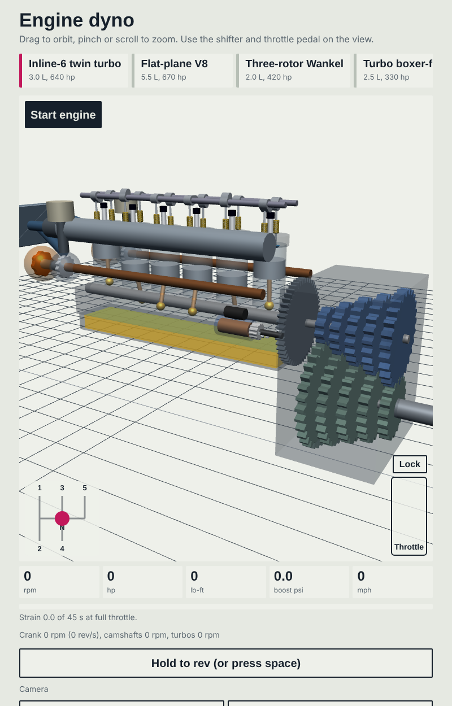
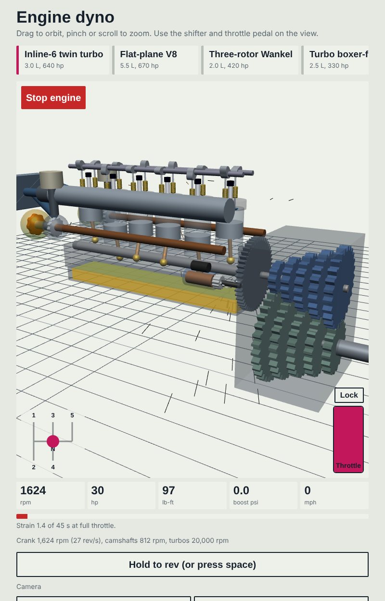
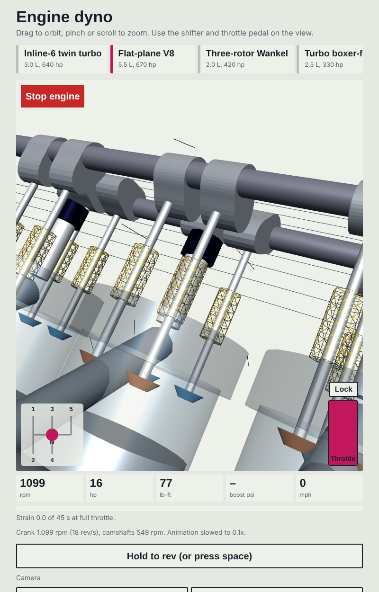
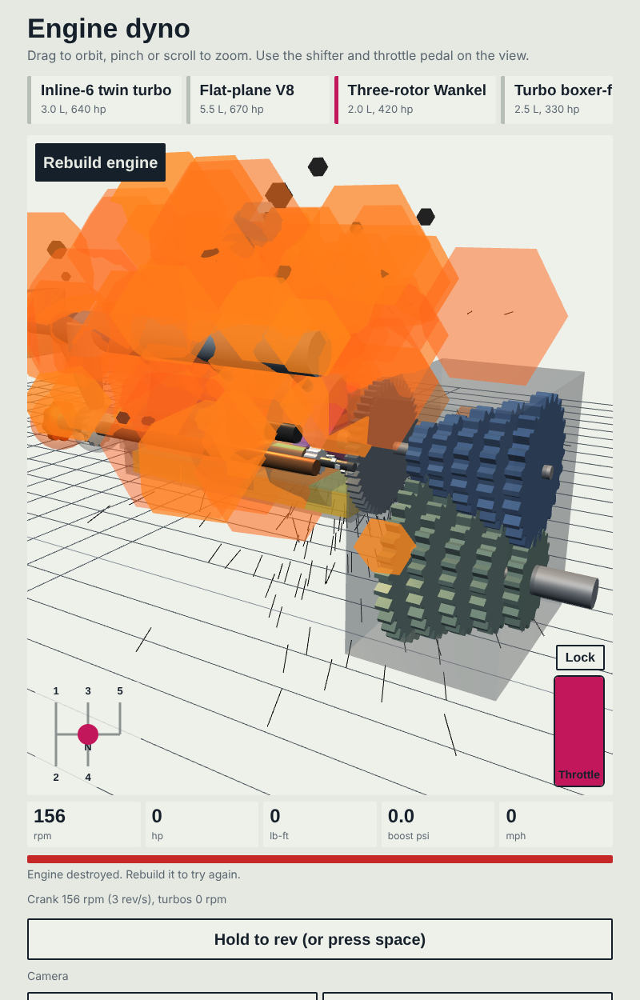

# Engine Dyno 3D

Adam's engine dynamometer simulator. A see-through 3D engine you can start, rev, shift and (if you push it too hard) blow up, all in your web browser.

## ▶️ Play it

**[Play Engine Dyno 3D](https://hardwaremack-prog.github.io/Engine-Dyno-3D/)**

Works on desktop and phone. No install needed. Turn your sound on.

## Screenshots

| Idle | Running |
|---|---|
|  |  |

| Valve close-up (V8, 1/10 speed) | Blown engine |
|---|---|
|  |  |

## Engines

| Engine | Size | Power | Redline |
|---|---|---|---|
| Inline-6 twin turbo | 3.0 L | 640 hp | 7,200 rpm |
| Flat-plane V8 | 5.5 L | 670 hp | 8,600 rpm |
| Three-rotor Wankel (turbo) | 2.0 L | 420 hp | 9,000 rpm |
| Turbo boxer-four | 2.5 L | 330 hp | 6,700 rpm |
| V12 | 6.5 L | 725 hp | 9,000 rpm |

## What it does

- Full 3D cutaway: pistons, rods, crank, cams, valves, spark plugs, turbos, intercooler, flywheel, starter and a 5-speed gearbox
- Real firing orders, rev limiter, turbo spool and lag, blow-off valve
- Engine sound made live from the rpm
- H-pattern shifter and throttle pedal on screen, plus "hold to rev" or the space bar
- Live readouts: rpm, hp, lb-ft, boost and mph
- Slow motion (1/10 and 1/100 speed), valve close-up, starter close-up and engine-start replay
- Oil level: run it dry and it seizes, overfill it and the plugs foul
- Hold full throttle too long and the engine blows up (rebuild button included)

## Controls

- **Drag** to orbit, **pinch or scroll** to zoom
- **Start engine**, then drag the **Throttle** pedal (tap **Lock** to hold it)
- Drag the **shifter** knob into a gear

## Run it yourself

It's one file: open `index.html` in any modern browser. It loads three.js from a CDN, so it needs internet the first time.
